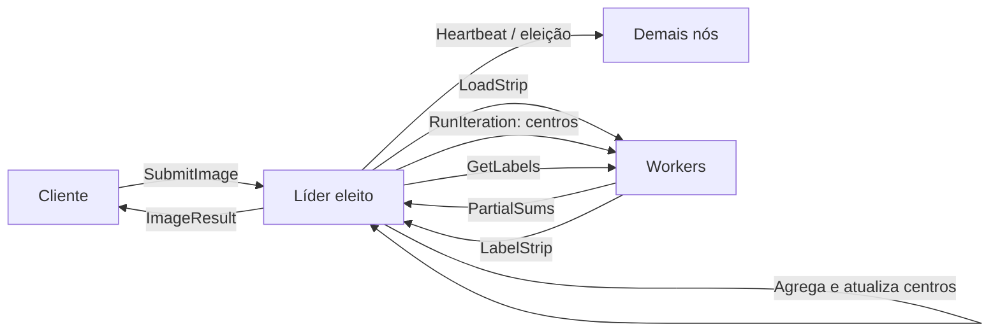

# SLIC Distribuído

Implementação acadêmica de segmentação de imagens com SLIC e distribuição do processamento entre processos Python que se comunicam por gRPC. O projeto atende ao contexto da disciplina de Computação Distribuída da PUC Minas, curso de Engenharia de Computação, conforme o enunciado fornecido ao grupo. Este README descreve o código atual; não há resultados de benchmark ou de execução aqui reportados.

O README da raiz é apenas um índice. Esta é a documentação técnica principal. Um relatório de auditoria e das alterações está em [`docs/RELATORIO_TECNICO.md`](../docs/RELATORIO_TECNICO.md).

## Objetivo e motivação

Segmentação de imagens divide uma imagem em regiões coerentes. SLIC produz superpixels: grupos compactos de pixels vizinhos, úteis como unidades menores para análise e processamento posterior. O trabalho distribui atribuições de pixels e somas parciais entre nós para exercitar RPC, paralelismo, eleição e ordenação lógica de eventos.

A divisão por faixas permite processar regiões diferentes em paralelo. O algoritmo ainda precisa de centros globais e de agregação por iteração; por isso, o líder calcula os novos centros antes de iniciar a iteração seguinte. O sistema não replica estado e não deve ser interpretado como serviço tolerante a qualquer falha.

## Fundamentação técnica

### Segmentação e SLIC

Segmentação associa um rótulo a cada pixel para formar regiões. Superpixels reduzem a quantidade de elementos sem abandonar totalmente a forma dos objetos. SLIC (Simple Linear Iterative Clustering) adapta uma ideia de agrupamento por cor e posição espacial a uma grade de centros iniciais.

O código converte a imagem RGB para CIELAB com `skimage.color.rgb2lab`. Para cada centro $c=(L_c,a_c,b_c,x_c,y_c)$, `slic_core.assign` calcula a distância quadrática:

$$
D^2(p,c) = (L-L_c)^2 + (a-a_c)^2 + (b-b_c)^2
           + \left(\frac{m}{S}\right)^2\left((x-x_c)^2+(y-y_c)^2\right)
$$

Aqui $p=(L,a,b,x,y)$ é o pixel, $m$ é a compactness, e $S$ é o espaçamento aproximado entre centros. A implementação compara $D^2$, sem calcular a raiz quadrada; isso preserva a ordem das distâncias não negativas. A busca de cada centro fica limitada à janela de coordenadas de até $S$ pixels em cada direção, recortada aos limites da imagem.

`slic_core.init_centers` estima $S=max(floor(sqrt(HW/k)),1)$ e coloca centros em grade nas posições `s // 2`, espaçadas por `s`. Por isso, o número efetivo de centros pode diferir do `k` pedido. Em cada iteração, `assign` atribui pixels aos centros mais próximos e `accumulate` soma $L,a,b,x,y$ e a quantidade de pixels por centro. O coordenador soma as parciais e `update_centers` calcula as médias; centros sem pixels mantêm a posição anterior. A iteração termina após `max_iter` ou quando o deslocamento médio espacial fica abaixo de `0.1` pixel.

Ao final, `enforce_connectivity` preenche pixels sem rótulo pelo rótulo vizinho mais próximo, identifica componentes conexos com conectividade 4 e funde componentes pequenos, com limiar `(S*S)//4`. Esse pós-processamento é realizado pelo líder sobre o mapa já agregado.

### SLIC distribuído e consistência das faixas

O líder converte a imagem completa para Lab e separa linhas contíguas entre os nós que responderam ao heartbeat. As linhas são divididas em intervalos semiabertos `[row_start, row_end)`. Cada worker recebe sua faixa, mas os centros mantêm coordenadas globais. `assign` considera centros cujas janelas espaciais alcançam cada pixel da faixa; não é necessária uma cópia de halo para essa implementação porque as atribuições são por pixel, seguidas de uma redução global.

Em cada iteração, o líder envia os centros, recebe somas e contagens por faixa, agrega cada partição uma vez e atualiza os centros. Depois recolhe os rótulos, ordena as faixas por linha inicial e verifica que cobrem a imagem sem lacunas ou sobreposição. A conectividade é aplicada depois da concatenação, portanto componentes que cruzam uma fronteira de faixa podem ser unidos no mapa global.

### Computação distribuída

Um sistema distribuído executa componentes em processos que podem estar em máquinas distintas e coordena seu trabalho por mensagens. Aqui, o cliente submete a imagem ao líder; o líder divide e agenda faixas; os workers calculam parciais; e o líder agrega as respostas. `ThreadPoolExecutor` executa chamadas de faixas em paralelo no processo coordenador. A comunicação é entre processos mesmo quando todos usam `127.0.0.1` na configuração de demonstração.

### gRPC e Protocol Buffers

RPC permite invocar uma operação remota através de uma interface. Protocol Buffers definem os tipos e a serialização binária dessas mensagens. O serviço `Node` está em [`proto/slic.proto`](proto/slic.proto); os stubs Python usados em tempo de execução são gerados em `node/slic_pb2.py` e `node/slic_pb2_grpc.py`.

| RPC | Uso no projeto |
|---|---|
| `SubmitImage(ImageRequest) → ImageResult` | Cliente envia imagem e parâmetros ao nó que acredita ser líder; resposta também pode indicar `leader_id`. |
| `LoadStrip(Strip) → Ack` | Líder carrega Lab e limites de uma faixa no worker. |
| `RunIteration(Centers) → PartialSums` | Worker atribui pixels e retorna somas e contagens da iteração. |
| `GetLabels(JobRef) → LabelStrip` | Líder coleta rótulos e limites da partição. |
| `Election(ElectionMsg) → ElectionAnswer` | Nó participa da eleição Bully respondendo que está ativo. |
| `Coordinator(CoordinatorMsg) → Ack` | Anúncio do novo líder. |
| `Heartbeat(Ping) → Ack` | Verificação de liveness. |

As chamadas de processamento são unary (uma requisição e uma resposta). As chamadas internas de faixa usam timeout de 30 segundos; heartbeat e mensagens de eleição usam timeout menor no módulo de eleição. O cliente limita `SubmitImage` a 180 segundos.

### Bully e heartbeat

Cada nó tem um ID inteiro positivo definido em `config.yaml`. Após atraso de inicialização, o nó consulta por RPC os nós de IDs maiores. Se nenhum responder, anuncia-se líder; se algum responder, aguarda o anúncio de coordenador e reinicia a eleição se ele não chegar. O nó que recebe pedido de eleição de ID menor inicia sua própria eleição.

Um nó que não é líder verifica o líder conhecido a cada dois segundos, com timeout de um segundo; duas falhas seguidas iniciam eleição. A leitura e atualização local da liderança são sincronizadas para que uma resposta atrasada de heartbeat não apague um anúncio recebido em paralelo. Anúncios com IDs desconhecidos ou menores do que o ID local são ignorados, e o nó dispara eleição no segundo caso. O protocolo atual não possui termo/época, quorum, consenso formal ou estado replicado. Um anúncio atrasado de um ID superior ainda não pode ser correlacionado a uma eleição específica; heartbeat pode detectar posteriormente que o líder não responde. Recuperar um job após falha do líder não está implementado.

### Relógios lógicos de Lamport

Relógios físicos de computadores diferentes podem divergir. Lamport fornece uma ordem lógica compatível com causalidade: um evento local ou envio chama `tick`/`send` e incrementa o contador; ao receber timestamp (t_m), `receive` atualiza para `max(t_local, t_m) + 1`. `LamportClock` protege o contador com `threading.Lock`.

O timestamp ordena eventos causalmente relacionados, mas timestamps iguais em processos diferentes não dão uma ordem total sozinhos. Os logs registram timestamp e ID de nó, além de campos opcionais de tipo, job, mensagem e iteração; ordenar por timestamp e depois nó cria uma apresentação determinística dos registros, não uma nova garantia de causalidade. Em `RunIteration`, Lamport ajuda a rejeitar pedidos antigos, enquanto job/partição/iteração e cache de resultados fazem o controle de duplicidade. O timestamp não é usado como identidade da tarefa.

### Falhas e idempotência

O coordenador faz heartbeat antes do job. Se `LoadStrip`, `RunIteration` ou `GetLabels` retorna erro RPC ou timeout, marca o worker indisponível para aquele job e tenta outro nó inicialmente ativo. Para um worker substituto, recarrega a faixa e repete a iteração necessária. As partições têm IDs derivados de UUID do job e índice; respostas recebidas são agregadas somente uma vez por partição. Uma resposta atrasada no worker anterior não é incluída naquela agregação. O worker serializa operações do mesmo job com lock, armazena a resposta da iteração mais recente e mantém o mapa de rótulos para retries de `GetLabels`.

Esse mecanismo não cancela cálculo que excedeu timeout. Um worker lento pode continuar consumindo CPU enquanto o substituto reexecuta a faixa. Falhas de RPC não recuperáveis ou ausência de workers terminam o job com erro informado ao cliente. A lista de tentativas vem dos nós que estavam vivos no início; nós que voltam depois não entram no job atual. Não há retomada depois da queda do líder, persistência durável, réplica ou transação distribuída.

## Arquitetura e fluxo de mensagens



Os workers são os nós da configuração que respondem ao heartbeat, incluindo o próprio líder por meio do seu stub local. Os contratos de mensagem são os definidos no `.proto`; não há streaming RPC.

## Estrutura do projeto

```text
TPCompDistribuida/
├── README.md                     # índice para esta documentação
├── docs/RELATORIO_TECNICO.md     # auditoria e registro das alterações
└── slic-dist/
    ├── client.py                 # valida imagem, envia RPC e grava visualização
    ├── config.yaml               # IDs, hosts e portas dos nós
    ├── requirements.txt          # versões das dependências
    ├── proto/slic.proto          # contratos gRPC
    ├── node/server.py            # servidor e estado dos workers
    ├── node/coordinator.py       # líder, distribuição e agregação
    ├── node/election.py          # Bully e heartbeat
    ├── node/lamport.py           # relógio lógico e logger CSV
    ├── node/slic_core.py         # núcleo SLIC e slic_local de referência
    ├── node/slic_pb2.py          # mensagens Protobuf geradas
    ├── node/slic_pb2_grpc.py     # stubs/handlers gRPC gerados
    ├── test_stale.py             # utilitário manual para mensagens antigas
    ├── foto.jpg                  # imagem de entrada incluída
    └── logs/                     # arquivos de log por nó
```

`resultado.png` é um artefato de saída presente no repositório, não um módulo do sistema.

## Requisitos e instalação

As versões em `requirements.txt` fixam gRPC/Protobuf de acordo com as versões exigidas pelos arquivos gerados, além das bibliotecas numéricas usadas pelo código. O README especifica Python 3.10 ou superior compatível com esses pacotes. A combinação não foi instalada ou executada durante esta auditoria.

### Windows PowerShell

```powershell
cd slic-dist
py -3.10 -m venv .venv
.\.venv\Scripts\Activate.ps1
python -m pip install --upgrade pip
python -m pip install -r requirements.txt
python -m grpc_tools.protoc -I proto --python_out=node --grpc_python_out=node proto/slic.proto
```

### Linux/macOS

```bash
cd slic-dist
python3 -m venv .venv
source .venv/bin/activate
python -m pip install --upgrade pip
python -m pip install -r requirements.txt
python -m grpc_tools.protoc -I proto --python_out=node --grpc_python_out=node proto/slic.proto
```

Os arquivos gerados já estão no repositório; o comando `protoc` é necessário quando o schema for alterado ou os stubs precisarem ser regenerados. Execute-o dentro de `slic-dist`. Não edite manualmente `slic_pb2*.py`.

## Configuração para vários nós

Todos os processos devem conhecer a mesma lista de IDs, hosts alcançáveis e portas. No modo local, o arquivo incluído configura três processos na mesma máquina:

```yaml
nodes:
  - {id: 1, host: 127.0.0.1, port: 50051}
  - {id: 2, host: 127.0.0.1, port: 50052}
  - {id: 3, host: 127.0.0.1, port: 50053}
```

Em computadores distintos, substitua cada host pelo endereço IP ou nome DNS anunciado pela máquina daquele ID, mantendo o mesmo arquivo topológico em todos os nós e no cliente. Libere TCP de entrada nas portas configuradas e conectividade entre os nós; permita também que o cliente alcance pelo menos os nós candidatos ao líder. O servidor escuta nas interfaces (`[::]`), mas os canais gRPC usam transporte sem TLS e sem autenticação. Use somente rede confiável. O parsing atual de `host:port` não documenta suporte a hosts IPv6 literais.

## Execução

Abra um terminal por nó, sempre com diretório atual `slic-dist`:

```powershell
python node/server.py --id 1
python node/server.py --id 2
python node/server.py --id 3
```

`server.py` aceita `--id` (obrigatório) e `--config` (padrão `config.yaml`). O processo aguarda a eleição inicial; o maior ID acessível tende a vencer Bully. Depois, no mesmo diretório, submeta uma imagem:

```powershell
python client.py foto.jpg --k 800 --out resultado.png
```

Argumentos do cliente: `image` (caminho obrigatório), `--k` (superpixels desejados, padrão 500), `--m` (compactness, padrão 10), `--iter` (iterações máximas, padrão 10) e `--out` (saída, padrão `resultado.png`). O cliente converte a imagem para três canais RGB de 8 bits, tenta nós por ID decrescente e segue `leader_id` quando outro nó informa o líder. O resultado é salvo como imagem com os limites dos superpixels.

O timeout do cliente é 180 segundos para o job completo; excedê-lo não cancela o cálculo já iniciado no líder. As chamadas internas têm seus próprios timeouts e política de redistribuição descrita acima.

## Logs e ferramenta de mensagens antigas

Cada nó grava `logs/node_<id>.log`, relativo ao diretório de execução. Na inicialização, o arquivo daquele ID é zerado. As linhas são CSV: timestamp Lamport, ID do nó, tipo de evento, job, mensagem, iteração e descrição. Campos indisponíveis ficam vazios. `rpc_failure` identifica falhas RPC e os eventos do job registram início, faixas carregadas e conclusão.

PowerShell, para ordenar os registros por relógio e desempatar pelo ID do nó:

```powershell
$logs = Get-Content .\logs\node_*.log | ConvertFrom-Csv -Header timestamp,node,type,job,message,iteration,event
$logs | Sort-Object @{Expression={[long]$_.timestamp}}, @{Expression={[int]$_.node}} | Format-Table
```

Bash:

```bash
cat logs/node_*.log | sort -t, -k1,1n -k2,2n
```

`test_stale.py` é um utilitário manual para enviar iterações com timestamps antigos. Ele espera um nó acessível no primeiro item de `config.yaml`. Não o execute contra um job de produção; sua finalidade é exercitar os handlers de descarte e cache.

## Situação dos mecanismos e limitações

| Mecanismo | Situação no código atual |
|---|---|
| RPC cliente/líder/worker | Implementado com gRPC unary e mensagens Protobuf; não validado em execução nesta revisão. |
| SLIC distribuído | Particionamento, cálculo de parciais, agregação e conectividade implementados; equivalência numérica não comparada com `slic_local`. |
| Paralelismo | Chamadas por partição executadas em `ThreadPoolExecutor`. |
| Bully/heartbeat | Implementados com timeout e detecção por falhas consecutivas; sem termos de eleição ou consenso formal. |
| Lamport | `tick`, `send`, `receive` e log timestamped implementados; timestamps não são IDs de tarefa. |
| Idempotência | Cache em memória por job/partição/iteração no worker; sem persistência e com retenção limitada. |
| Falha de worker | Timeout/erro tenta outro worker que respondeu inicialmente ao heartbeat; o job falha se não houver candidato restante. |
| Falha do líder | Eleição pode escolher outro líder, mas estado do job não é replicado e não há retomada. |
| Desempenho | Existe referência local `slic_local`; não há comparação executada distribuído versus local. |
| Réplicas/2PC | Não implementados. |
| Segurança | Sem TLS ou autenticação; rede confiável necessária. |

O worker guarda a faixa Lab, rótulos e resposta da iteração mais recente durante um job. Ao devolver rótulos, converte o mapa em bytes e libera os arrays Lab/rótulos e cache de somas. Jobs inativos há mais de uma hora são removidos de forma preguiçosa ao receber heartbeat ou uma nova faixa; jobs concluídos também podem ser removidos para manter o dicionário abaixo de 64 entradas. Isso não é armazenamento durável nem limite de memória por bytes. Uma operação que excede timeout pode continuar executando no worker original.

## Trabalhos futuros e entregas acadêmicas

Para a primeira entrega, o relatório do artigo deve explicar o problema, arquitetura, payloads RPC, Bully, Lamport, desafios e contribuição individual, com evidências de execução realmente coletadas pelo grupo.

Para a segunda entrega, são necessários tratamento de falhas adequado e pelo menos uma expansão acadêmica escolhida pelo grupo: análise comparativa de desempenho, controle de réplicas ou consistência transacional. A implementação atual não apresenta resultados de desempenho e não implementa réplicas ou Two-Phase Commit. Também são evoluções possíveis persistir estado, recuperar jobs após falha do líder, autenticar/cifrar a comunicação e avaliar mais workers. O relatório interno documenta estado e riscos; ele não substitui o artigo da disciplina.
